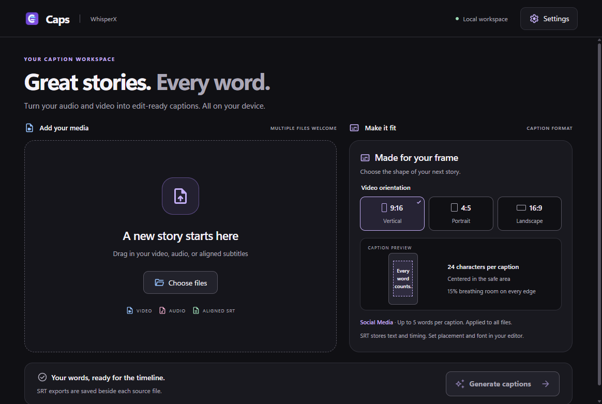
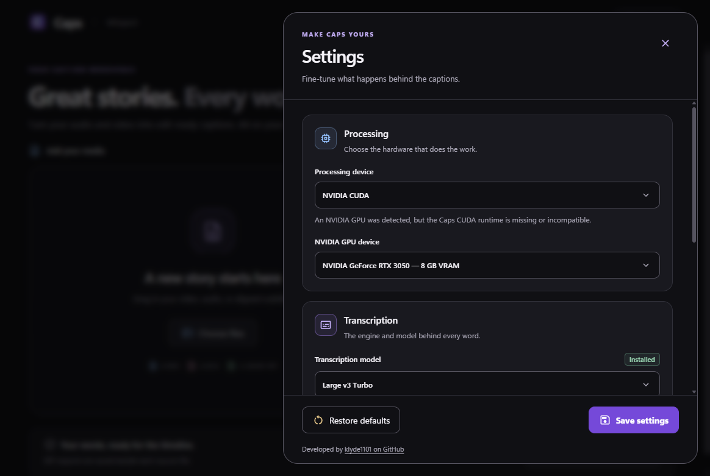

# Caps UI redesign draft

The redesign is implemented in the desktop source and rebuilt into `Caps-1.0.0-beta.2.exe` on October 24, 2026. Matching executable copies are available in the project root and `dist/`. The portable executable passed launch, orientation, subtitle export, and renderer-error checks.

## Home

A quieter charcoal workspace with the Caps purple accent, a larger heading, and a two-step flow: add media, then choose the caption format. The import area supports the existing multi-file workflow. Orientation choices include a live safe-area preview, and the export action has a dedicated summary bar. Processing, results, and error screens use the same colors and controls.

## Settings

A floating Settings panel groups controls into Processing, Transcription, and Performance cards. Timing and diagnostics remain expandable. The header and save actions stay visible while the settings content scrolls. The dialog fills narrow windows, traps keyboard focus, closes with Escape, and returns focus to the opening control.

## Responsive behavior

The main window starts at 1180 × 820. Fixed minimum and maximum sizes are removed, and resizing, maximizing, and fullscreen are enabled. The startup splash keeps its compact size.

The home panels stack below 760 pixels. Below 480 pixels, the export action fills its own row and Settings fills the viewport. Short windows scroll vertically, and wide windows use a centered content area for readability. Caption tables can scroll horizontally within their own container.

## Validation

- Full automated suite: 141 passed, 1 skipped.
- Focused desktop and workflow checks after final source edits: 23 passed.
- Electron layout harness: 64 screen and size combinations passed with no horizontal page overflow or overflowing workflow cards. It covers ready, selected files, setup notice, completion, processing, error, Settings, and Settings with a second GPU.
- Window sizes: 320 × 640, 375 × 812, 768 × 1024, 780 × 500, 1024 × 640, 1180 × 820, and 1920 × 1080, plus 1180 × 820 at 150% zoom.
- Interaction checks cover orientation previews, model and engine switching, Smart Mode, dialog focus trapping, Escape dismissal, saving, and retained timing values.

The UI harness uses fixture data; it does not run a media transcription job. Full screenshots and measurement reports are stored locally under `caps-build-qa/redesign-ui/`.

## Colored icons

Google Material Symbols Rounded from https://fonts.google.com/icons are now used for media import, file types, caption formatting, Settings categories, timing, diagnostics, and actions. Purple, blue, amber, rose, and mint accents distinguish their roles. Text labels remain in place, and decorative symbols are hidden from assistive technology.

All 21 SVGs and their Apache 2.0 license are bundled in `src/assets/material-symbols/`. They render offline through CSS masks. The rebuilt portable executable includes the icons and passed launch, orientation, and subtitle-export checks with no renderer exceptions. The 64 responsive layout checks and full automated suite (141 passed, 1 skipped) also passed.
